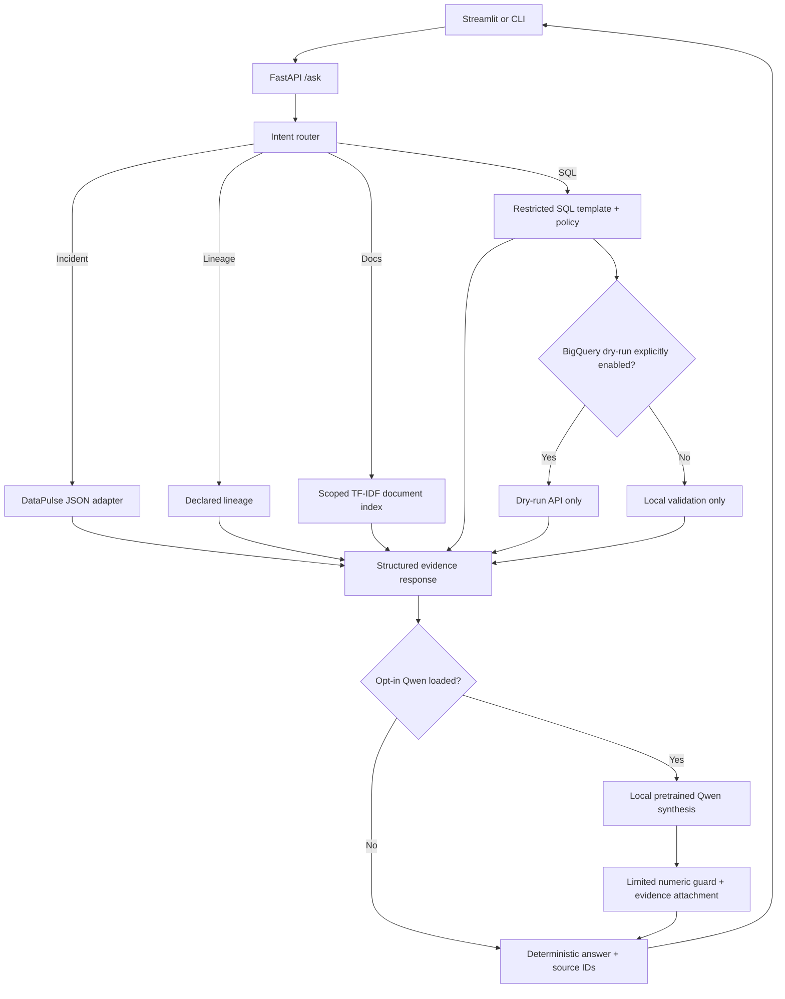

# DataForge AI — MVP architecture

## Boundaries

* DataForge is a separate repository and imports no internals of DataPulse.
* Each connector is a project-scoped object with methods `get_project_overview`, `list_incidents`, `get_incident`, `get_lineage`, `list_available_tables`, `get_schema`, and `execute_read_only_query` (explicitly disabled in DataPulse MVP).
* Default backend is deterministic: it never downloads model weights, makes cloud calls or fabricates generated conclusions.
* The 1.5B pretrained model is **optional**. No fine-tuning or training from scratch is implemented.
* The vectorization baseline is TF-IDF; FAISS and embeddings are not implemented.
* BigQuery demo table names are metadata only. No actual tables, credential bindings or successful cloud dry runs are claimed.

## Evidence and data flow

Documents are ingested from one approved `knowledge` directory, split into bounded heading chunks, tagged with relative file paths and internal source IDs, and retrieved by TF-IDF similarity. Incident JSON and lineage metadata come from a configured on-disk export, not model generations. Source attribution is returned with every supported answer. The intent router selects the source and the response generator returns structured evidence, uncertainty notes and action recommendations.

## Intended extension for real DataPulse

1. Run and verify DataPulse independently (especially its own Qwen output, replay and deterministic report).
2. Export **sanitized** incident, lineage and schema records to a separate folder matching `docs/ADAPTER_CONTRACT.md`.
3. Set `DATAFORGE_DATA_DIR` to that export. Do not modify DataPulse code or repository.
4. Validate incident IDs, numerical replay evidence and consistent timestamps.
5. Replace demo BigQuery table identifiers with *approved* real table IDs only after a read-only IAM review.
6. Run tests and human-review answers against actual generated output before claiming end-to-end integration.
